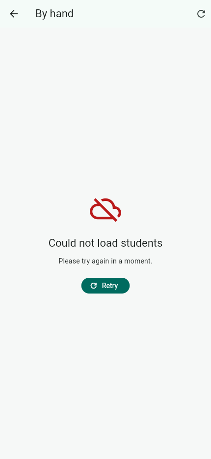
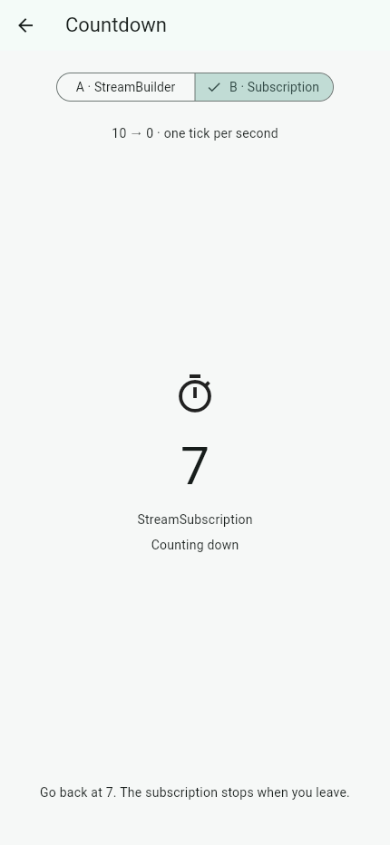

# Practice 10 — The Data Arrives Later

A complete Flutter async lab: a deterministic fake server, four student states,
FutureBuilder, two countdown implementations, and honest asynchronous saving.

## Run

```sh
cd practice_10
flutter pub get
flutter run
# Or: flutter run -d chrome
```

Flutter 3.47.4 / Dart 3.13.3 were used for verification. Android and Web platform
files are included. No backend, API key, or additional setup is needed.

## Try every state

1. **By hand**: wait two seconds for six students. Reload twice: request 3
   shows the error screen. Retry starts request 4 and returns the list.
2. **FutureBuilder**: flip Dense ten times; there is still only one request.
   Reload twice to see the error, then Retry. The Future changes only on reload.
3. **Empty dataset** on the home screen selects `FakeApi(empty: true)` for
   either student screen. A completed empty response displays No students yet.
4. **Countdown**: choose A (StreamBuilder) or B (explicit subscription).
   Both reach zero; switching versions starts a new countdown. Leave at 7:
   no further ticks and no disposed-state errors.
5. **Save**: open By hand and save. The first save succeeds and returns home.
   Reopen and save again: `server rejected 6` appears in a SnackBar and the
   screen stays open. During saving the button is disabled. The home screen
   owns API instances so request/save counters survive route visits.

## Verify

```sh
dart format .
flutter analyze
flutter test
flutter build web
```

13 tests cover request delays, concurrent calls, failures, empty responses,
retry, ten density toggles, disposal, save double taps, both countdowns, and
isolated deliberately broken examples. See [NOTES.md](NOTES.md) for observations
and corrections to ambiguities in the assignment.

## Screenshots from the running app

| Third request fails | Version B at 7 |
| --- | --- |
|  |  |

## Files

- `lib/api/`: fake server, Student model and countdown generator.
- `lib/widgets/`: loading, error, empty and list views.
- `lib/students_screen.dart`: manually managed state and awaited save.
- `lib/students_future_screen.dart`: stored Future and independent density state.
- `lib/countdown_screen.dart`: automatic and explicit subscription ownership.
- `test/experiments_test.dart`: unsafe variants isolated from the working app.
