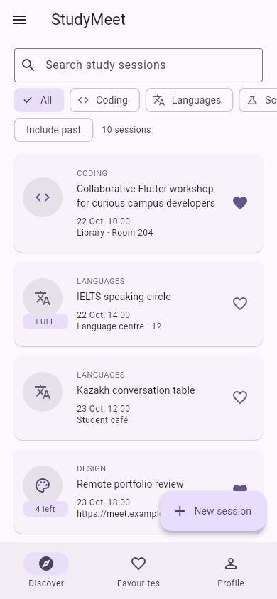
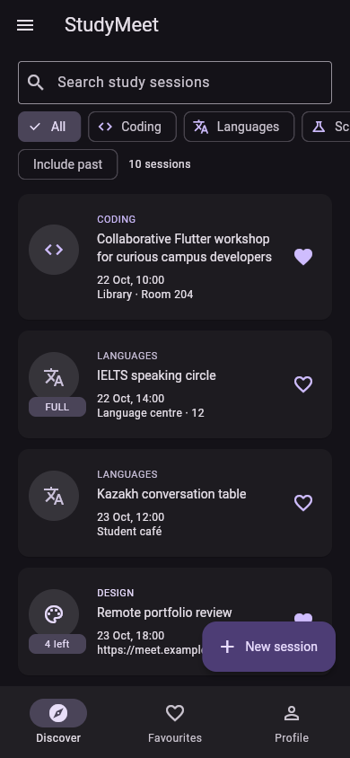
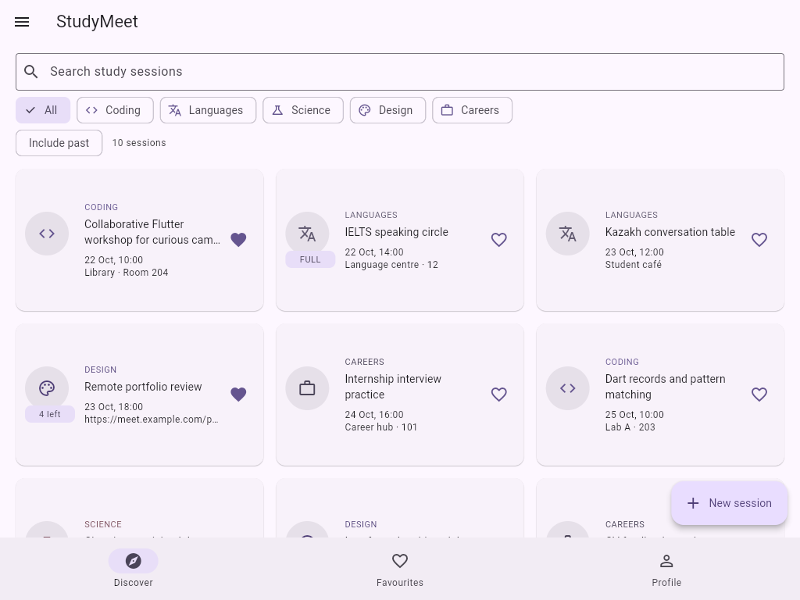

# StudyMeet

Студенттердің оқу кездесулеріне тіркелу қосымшасы. Кездесуде санат, күн, орын не онлайн сілтеме, қатысушылар шегі мен тізімі бар. Барлық дерек жедел жадта сақталады, қайта іске қосқанда 12 бастапқы мысал қалпына келеді.

## Іске қосу

Flutter 3.47.4 және Dart 3.13.3 ортасында тексерілді. Осы қалтаны VS Code немесе Android Studio ішінде ашыңыз.

```sh
flutter pub get
flutter run -d edge
```

Chrome үшін `flutter run -d chrome`. Android эмуляторын немесе USB debugging қосылған телефонды іске қосып, `flutter devices`, содан соң `flutter run -d DEVICE_ID` орындаңыз. Алғашқы жинауға интернет қажет болуы мүмкін; қосымшаның өзі желіге сұрау жібермейді.

```sh
flutter analyze
dart format --output=none --set-exit-if-changed .
flutter build web --no-web-resources-cdn
flutter build apk --debug
```

Соңғы команда дайын Android SDK мен Java талап етеді. Осы жеткізілімде APK жиналған жоқ.

- [Толық қазақша түсіндірме](docs/EXPLANATION_KK.md)
- [R1–R41 талаптар картасы](docs/REQUIREMENTS.md)
- [Қорғаудағы 16 тапсырма](docs/DEFENCE_KK.md)
- [Тексеру нәтижелері](docs/VERIFICATION.md)

## Скриншоттар

Іске қосылған Flutter Web нұсқасының телефон және планшет өлшемдеріндегі суреттері. Android құрылғысынан алынған суреттер емес.

### Телефон ашық тақырып


### Телефон қараңғы тақырып


### Планшет торы


## Decisions

The meeting list and profile live in Shell State so all three tabs share a single source of truth.
Tabs receive values through constructors and send changes back through callbacks instead of owning separate copies.
The detail route receives an initial meeting and callbacks because joining, leaving, editing and deleting must update the shell immediately, while its local snapshot keeps the visible detail current.
The form returns a Meeting through Navigator.pop because a cancelled edit must never mutate the original item.
LayoutBuilder selects the list or grid from the actual available width, with a 600 px breakpoint and cells no wider than 360 px.
PopScope compares all current form values with their opening snapshot, so reverting an edit makes the form clean again and successful Save bypasses the discard dialog.
With week 9 tools, I would move shared state behind a notifier and repository and add persistence, then replace name-based membership with stable user IDs when the course introduces them.

## GitHub арқылы тапсыру

Жергілікті Git тарихы жобамен бірге берілген; `.git` қалтасын сақтаңыз. `git log --oneline` арқылы коммиттерді көріңіз. Өз GitHub аккаунтыңызда бос репозиторий ашып, оның URL мекенжайын қойыңыз:

```sh
git remote add origin YOUR_REPOSITORY_URL
git push -u origin main
```

Бұл жеткізілімде GitHub репозиторийі құрылмаған, жоба жарияланбаған. Коммиттер AI көмекшісі жасаған өзгерістерді көрсетеді; олар студенттің өз бетінше жұмыс істеу тарихы ретінде ұсынылмайды.
